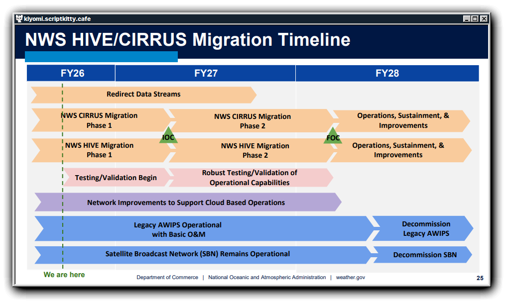

<div align="center" style="margin-top: 20px;">
    <a href="https://atmosphericx.scriptkitty.cafe">
        
    </a>
    <p style="font-size: 1.1em; max-width: 700px;">
        A robust TypeScript library for parsing and ingesting NOAA and NWS Weather Products and other related data formats including an expanded suite of quality‑of‑life tools for faster, cleaner, and more reliable development.
    </p>
    <small style="display: block; margin-top: 10px;">
        Built and maintained with ❤️ by the AtmosphericX team<br>
        <i>Not affiliated with NOAA or NWS</i>
    </small>
    <hr style="width: 60%; margin: 25px auto; opacity: 0.3;">
    <p style="text-align: center; font-size: 1.05em;">
        <a href="https://atmosphericx.scriptkitty.cafe"><b>Official Documentation</b></a> &nbsp;•&nbsp;
        <a href="https://github.com/AtmosphericX"><b>Github Organization</b></a> &nbsp;•&nbsp;
        <a href="https://www.npmjs.com/search?q=%40atmosx"><b>Packages</b></a> &nbsp;•&nbsp;
        <a href="/.github/CHANGELOGS.md"><b>Changelogs</b></a> &nbsp;•&nbsp;
        <a href="https://atmosphericx-discord.scriptkitty.cafe"><b>Community Discord</b></a>
    </p>
</div>


## Introduction
Formally known as *atmosx-nwws-parser*, **@atmosx/event-product-parser** is a TypeScript library designed to parse and ingest National Oceanic and Atmospheric Administration (NOAA) and National Weather Service (NWS) weather products, as well as other related data formats. The library provides a comprehensive suite of tools for developers to efficiently handle weather data, ensuring faster, cleaner, and more reliable development processes. 


### Package Installation

**Node Package Manager (NPM)**: 
```bash
$ npm install @atmosx/event-product-parser
```

**Performant Node Package Manager (PNPM)**:
```bash
$ pnpm install @atmosx/event-product-parser
```

### Usage

**Typescript**:
```typescript
import { Manager } from "@atmosx/event-product-parser"
const manager = new Manager({...settings})
```

**Javascript**:
```javascript
const { Manager } = require("@atmosx/event-product-parser");
const manager = new Manager({...settings});
```

### Dependencies
- [xml2js](https://www.npmjs.com/package/xml2js) (v0.4.14)
- [@xmpp/client](https://www.npmjs.com/package/@xmpp/client) (v0.14.0)
- [better-sqlite3](https://www.npmjs.com/package/better-sqlite3) (v12.9.0)
- [croner](https://www.npmjs.com/package/croner) (v10.0.1)
- [d3-geo](https://www.npmjs.com/package/d3-geo) (v3.1.1)
- [esbuild](https://www.npmjs.com/package/esbuild) (v0.28.1)
- [jszip](https://www.npmjs.com/package/jszip) (v3.10.1)
- [polygon-clipping](https://www.npmjs.com/package/polygon-clipping) (v0.15.7)
- [shapefile](https://www.npmjs.com/package/shapefile) (v0.6.6)
- [sharp](https://www.npmjs.com/package/sharp) (v0.35.3)
- [topojson-client](https://www.npmjs.com/package/topojson-client) (v3.1.0)
- [typescript](https://www.npmjs.com/package/typescript) (v5.9.3)

### Diclaimer

> [!WARNING]
> This project is currently in **active development** and is not yet ready for production use. The library is undergoing a major rewrite to support the retirement of AWIPS and the transition to a fully cloud-based infrastructure. CIRRUS will become the new standard for ingesting and parsing NOAA and NWS products, and this project is evolving to support that transition. Specifically with CAP v1.2 ingestion.


